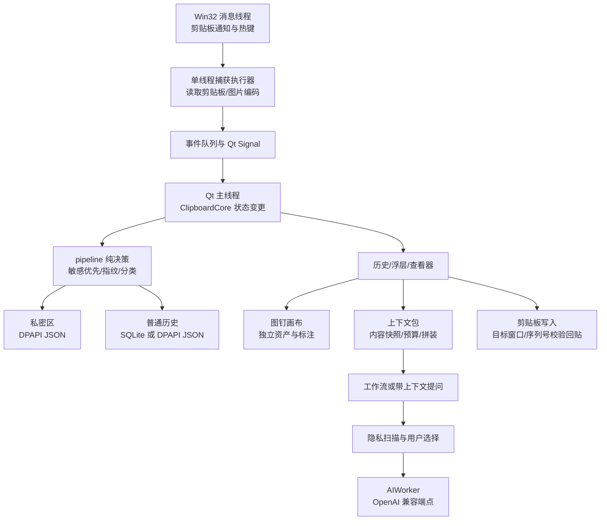

# WinClipboard 完整项目分析报告

分析日期：2026-10-13（Asia/Shanghai）。分析对象：当前本地工作区，分支 `feature/ctx-pack`，HEAD `6d121108a301d7fb3852c60355dc868dff625cf9`，版本声明 `1.0.0-rc1`。

本报告基于当前源码、Git 元数据、依赖实装版本、隔离回归检查、临时数据复现和本地打包归档检查。旧分析报告仅用于了解背景，不作为本次测试通过或性能达标的证据。没有修改业务实现，也没有提交、安装或发布新版本。

## 1. 总体结论

WinClipboard 已经是一个功能相当完整的 Windows 本地剪贴板工作台：以文本、文件、图片历史为底座，提供内容解析、隐私隔离、快捷粘贴、图片处理、图钉画布、多步骤 AI 工作流和上下文包。它有实际产品结构、较厚的故障回归积累，以及明确的失败处理语义，不能简单视为一个原型脚本。

但当前分支仍有应在发布前处理的数据一致性和恢复路径缺陷。最值得优先解决的是：

1. 安全模式仍会执行历史自动清理，退出保存时还会把未恢复的画布写为空画布。
2. 导入记录的置顶与原时间只改了内存，SQLite 中仍是未置顶和导入时间。
3. 新上下文包路径没有被部分旧测试隔离，默认测试入口存在触及真实包文件的风险。
4. 本地 EXE 与当前源码不一致，不能用现有 EXE 证明当前功能可交付。

默认检查 **13/13 通过**；补跑上下文包存储、界面、工作流测试 **20 + 14 + 9 项通过**。这说明既有回归基线健康，但不等于没有缺陷：本次新增边界复现同时确认了图片入包异常、搜索语义分歧、包读取容错不足等问题。

建议当前阶段定位为“可持续开发、应先收口可靠性的候选版本”。产品方向已经清楚，下一步应集中修复数据生命周期、补验收和建立发布证据。

## 2. 基线与分析范围

### 2.1 当前可核实的事实

| 项目 | 当前事实 |
|---|---|
| 应用版本 | `app_meta.py` 声明 `1.0.0-rc1` |
| 分支 | `feature/ctx-pack`，不是旧报告中的 main |
| HEAD | `6d12110`，最新提交为托盘图标注册失败降级和 `WCLB_SHOW_ON_START` |
| 当前分支可达提交数 | 91 |
| 初始工作区 | `git status --short` 无输出；分析开始时干净 |
| 平台 | Windows 专用；Win32、DPAPI、注册表和 Explorer 深度参与 |
| 运行入口 | `winclipboard_qt.py` |
| 产品及支撑 Python | 35 个文件、20,552 行，包含 `run_checks.py` 等支撑模块 |
| Python 测试脚本 | 20 个、7,738 行；不包含 PowerShell 安装测试 |
| 分类语料 | 8 个 JSON 文件、41 个样本 |
| 最大文件 | `winclipboard_qt.py` 4,027 行；`clipboard_manager.py` 3,587 行 |
| 当前构建产物 | `dist/WinClipboard/WinClipboard.exe` 存在，修改时间为 2026-10-07；归档与源码比对不通过 |

行数按物理行统计，包含注释和空行，不等于有效逻辑行数。测试和工具文件、图片文档、旧报告、生成产物不能混在同一“业务规模”数字里。

### 2.2 本次覆盖与限制

覆盖产品所有主要子系统及启动、持久化、回贴、迁移、清理、导入导出、工作流、上下文包、诊断、构建与安装保护链路。对问题进行了有针对性的函数级和离屏组件复现。

没有执行真实剪贴板集成测试、向用户窗口注入按键、重启用户实例、正式安装/卸载、联网 AI 请求、重新构建 EXE，也没有重新进行全页面视觉验收。真实多屏/DPI、RDP、Explorer 重启、热键冲突和长时间常驻行为，不能由离屏测试替代。

初次默认检查按项目提供的 `run_checks.py` 执行，继承了调用环境的 APPDATA。后续审查发现部分旧套件漏隔离 `CTXPACK_FILE`，因此后续上下文包检查、缺陷复现和基准均使用单独 APPDATA 沙箱。不能将首次默认检查描述为“所有路径已严格隔离”，也没有证据可以断言它实际修改了用户包文件。该风险详见第 7 节。

## 3. 产品能力与功能成熟度

| 子系统 | 已实现能力 | 当前评价 |
|---|---|---|
| 历史记录 | 文本、HTML/RTF、文件列表、图片；来源、去重、置顶、过滤、批量删除、撤销、自动清理 | 主路径成熟；导入和恢复组合路径有缺陷 |
| Windows 集成 | 系统托盘、主窗热键、快捷浮层、直钉图片、鼠标穿透、自启动、单实例、焦点回贴保护 | 平台实现完整；真实桌面验收仍需独立证据 |
| 内容查看 | JSON、代码、Markdown、CSV、URL、JWT、Base64、XML、图片及内容对比 | 特色明显；分类规则覆盖面小，JWT 仅解码不验签 |
| 隐私 | 敏感区、遮罩、DPAPI、API 密钥加密、AI 发送前扫描与遮盖、应用排除 | 失败保护较好；不是完整敏感信息识别系统 |
| 图片编辑 | 裁剪、旋转、缩放、压缩、矩形、箭头、文字、马赛克 | 功能丰富；需独立验证大图内存和导出行为 |
| 图钉画布 | 多图、布局、层级、锁定、缩放平移、非破坏标注、独立资产 | 包结构较清晰；安全模式保存存在数据恢复风险 |
| AI 工作流 | API AI、网页 AI、人工确认、复制、文本变换、条件判断，逐步编辑和运行记录 | 统一契约值得保留；模板替换和线程收尾仍需强化 |
| 上下文包 | 内容快照、活动包、角色和优先级、预算、XML/Markdown 拼装、复制、`{context}`、带上下文提问 | 当前分支已实现 P1–P4；图片映射和持久化边界尚未闭合 |
| 运维 | 诊断、健康检查、安全模式、备份迁移、更新检查、安装目录标记保护 | 有较完整工具链；安全模式承诺与实现不一致，构建落后源码 |

上下文包的 P5 轻量会话、P6 AI 压缩在 `CTX_PACK_PLAN.md` 中列为可选未做，不能当成已有能力。图片在包中设计为元信息引用，并不会自动成为发送给 AI 的多模态图片附件。

产品优势来自“复制 → 查看/整理 → 拼装上下文 → 工作流处理 → 回贴”的连续操作链。功能已足够多，未来扩展前应先降低交互发现成本，明确普通历史、私密区、图钉画布和上下文包各自的生命周期。

## 4. 架构与核心数据流

### 4.1 模块责任

| 层次 | 核心文件 | 责任与评价 |
|---|---|---|
| 应用/UI 编排 | `winclipboard_qt.py` | 主窗口、五页导航、历史卡片、设置、缩略图、动作与退出编排；责任仍然偏多 |
| 核心状态 | `clipboard_manager.py` | 捕获、过滤、记录变更、回贴、清理、导入导出、迁移，另含分类、网络和工具函数 |
| 平台适配 | `win32_host.py` | ctypes 原型、托盘消息循环、热键、剪贴板通知、SendInput、单实例 |
| 捕获决策 | `pipeline.py` | Snapshot 规范化、敏感优先、指纹去重、分类、CaptureTrace；纯决策层清楚 |
| 历史仓库 | `store.py` | SQLite/WAL、schema v3、FTS5、软删除、组合查询、blob 引用 |
| 密封存储 | `privacy_store.py`、`history_store.py` | 私密区状态机、DPAPI、JSON 备份、加密模式切换辅助 |
| 内容 UI | `viewer.py`、`image_editor.py`、`quickpaste.py` | 查看、处理、浮层操作，与主模块仍通过 app/core 属性耦合 |
| 工作流 | `workflow_steps.py`、`workflow_ui.py`、`workflow_runlog.py` | 六类步骤契约、GUI 宿主、长度/状态运行记录 |
| 图钉包 | `pinboard/` 11 文件 | model/storage/layout/loader/view/items/window/manager 分工，是进一步拆分的参考 |
| 上下文包 | `ctxpack/` 8 文件 | dataclass、估算/分配、拼装、存储、服务、托盘 UI、提问对话框 |
| 支撑 | `app_meta.py`、`ui_base.py`、`diagnostics.py`、`perf_probe.py` | 元数据、主题、健康与性能诊断 |



### 4.2 值得保留的设计

- **敏感探测先于去重**：重复复制敏感文本不会被普通历史去重提前吞掉。
- **后台捕获、主线程编排**：大图编码不在 Win32 消息线程里执行；事件桥使用 Qt 队列连接，减少轮询唤醒和重入。
- **写剪贴板成功后才派发粘贴**：失败不假报成功，也不把历史提升当成成功副作用。
- **画布、上下文包与历史解耦**：删除历史不会自然导致独立快照或画布资产失效。
- **步骤契约可测试**：同步 Done、人工 Wait、异步 Job、Cancelled，以及注入宿主能力，比把所有分支放在 GUI 中更易扩展。
- **有界图片缓存与列表物化**：缩略图按字节和数量约束，历史卡片采用滑窗和分批构建。

### 4.3 当前架构负担

模块拆分保留了大量兼容重导出，`from ui_base import *`、运行期 `_cm()` 回查和通过 app 属性访问功能，使模块虽然分开，却仍存在隐式依赖。它们对旧接口和测试打桩有价值，后续应逐步用清楚的服务接口代替，不宜一次性删掉兼容层。

按 AST 统计，设置页构造函数约 392 行，历史页构造函数约 241 行；最大业务/UI 文件超过 4,000 行。大型构造函数不是直接缺陷，但说明设置编排、窗口生命周期和数据服务仍适合继续拆分。

历史同时存在 SQLite 和加密 JSON 两套路径；多处变更还要同步内存列表、指纹索引、位置映射、来源缓存、未置顶计数与磁盘。导入缺陷正是这种“先写库，再补改内存”的同步负担产生的实际问题。

## 5. 存储、隐私与失败语义

### 5.1 数据事实源

默认数据目录来自 `%APPDATA%/WinClipboard`，开发启动器另设 `.runtime_appdata`。

| 数据 | 事实源/保护 | 生命周期要点 |
|---|---|---|
| 普通历史 | `clipboard.db`，SQLite WAL，schema v3 | 常规写透；活跃/软删除状态；启动仍全量加载 |
| 加密历史 | `history.json`，DPAPI 容器及滚动副本 | 模式切换先落新事实源与配置，再清理旧数据库 |
| 历史图片 | `data/blobs/<前两位>/<hash>`；兼容旧 `images/` | 按像素内容去重、引用和宽限期决定回收；未被历史加密开关加密 |
| 私密区 | `private.json`，DPAPI，bak1–3 | ok/missing/recovered/unreadable；不可读禁止自动覆写 |
| 配置 | `config.json` | API 密钥字段 DPAPI；密封失败中止保存 |
| 画布 | `pins/board.json`、独立图片 | 原图和标注分离；主文件及 bak1 |
| 上下文包 | `context_packs.json` | 独立快照；加密跟随历史开关；当前明文模式不轮转备份 |
| 工作流记录 | `workflow_runs.json` | 默认 50 条；长度、状态、耗时和脱敏错误，不记录输入/输出正文 |
| 跨机器备份 | PBKDF2 + AES-256-GCM 容器 | 用户密码迁移；私密内容默认不包括；独立于 Windows DPAPI |

SQLite 的 FTS5 表与触发器确实存在，但主搜索使用 `LIKE '%q%'` 子串匹配，不能宣称实际搜索已经享受 FTS 分词索引加速。参数化查询有助于控制 SQL 注入风险，与字面搜索语义是否正确是两回事。

### 5.2 安全边界

DPAPI 主要保护静态磁盘数据，绑定当前 Windows 用户；不能防御已获得同一用户权限的恶意进程。历史加密开关也不覆盖独立图片、画布资产、主动导出的明文文件或剪贴板本身。

敏感隔离是规则识别，不是对全部秘密、个人信息或截图内容的保证。捕获探测 `_sensitive_reason` 与发送前子串扫描 `privacy_scan` 用途不同：嵌入长文本的凭据不一定按照独立整条凭据的隔离方式处理。上下文包宿主也注入了 `_sensitive_reason`，不应将“未命中”显示成“内容安全”。

AI 网络入口支持用户配置 HTTP/HTTPS。HTTP 对本地 Ollama 有合理用途；远程服务配置和目标域名需要清楚呈现。隐私门发生在调用前，但模型端是否保留数据由外部服务决定，本次没有访问外部服务进行审计。

拼装器的“资料不是指令”声明、闭合标签转义和 Markdown 围栏属于格式与提示边界，不能构成对模型提示注入的强制安全隔离。Token 预算也是启发式估算；“约 ±20%”是实现声明，本次未使用多个模型的真实 tokenizer 验证误差分布。

## 6. 实测验证与性能

### 6.1 测试结果

| 检查 | 本次结果 | 结论边界 |
|---|---|---|
| `run_checks.py` 默认 13 套 | 13/13 PASS | core/storage/ai/pinboard/classifier/privacy/clipboard-failure/capacity/runlog/pagecount/module-split/perf-semantics/ctxpack |
| `_ctxpack_store_test.py` | 20 项 OK | 原子写、故障注入、迁移、服务与集成 |
| `_ctxpack_ui_test.py` | 14 项 OK | 离屏几何、状态、敏感拦截和放行等 |
| `_ctxpack_workflow_test.py` | 9 项 OK | `{context}`、发送内容、取消和兼容 |
| 审计复现脚本 | 9 个场景完成 | 输出实际异常或状态差异；不是“9 个业务测试通过” |
| EXE 归档比对 | 不通过 | 首个差异模块 `clipboard_manager`；没有运行该 EXE |
| 真实集成/安装/视觉全验收 | 未执行 | 旧文档结果不能替代当前分支结果 |

当前默认入口只登记了 `_ctxpack_test.py`，**没有登记另外三组上下文包测试**。功能测试可以通过，关键组合缺陷仍然遗漏；建议将补跑三组纳入统一门禁，并补齐本报告的交叉路径。

测试结构以独立脚本和部分 unittest 为主，子进程隔离能减少全局状态污染。短板是共享 fixture 不统一，新路径增加后旧套件容易漏重定向。仓库未见 `.github` CI 工作流，当前质量证据依赖本地手工执行。

分类语料 41 条，其中误报语料 11 条。它适合作为黄金回归小集，不能证明真实用户数据分布上的 precision/recall；需要长文本、混合类型、非英文代码、URL 尾标点、无效 JWT、Base64 与普通短串等更多样本。

### 6.2 性能结果与口径

首次基准在系统临时目录建库时报 `sqlite3.OperationalError: unable to open database file`，没有生成有效性能结果。将 APPDATA/TEMP/TMP/SQLITE_TMPDIR 指向工作区独立临时目录后重新测量。环境失败不算产品算法性能失败。

共完成三轮有效基准，每轮脚本内部另有重复采样。下表各轮数字为该轮中位数，“汇总中位数”取三轮中位数的中位数，单位均为 ms。

| 场景 | 第 1 轮 | 第 2 轮 | 第 3 轮 | 汇总中位数 | 脚本预算 |
|---|---:|---:|---:|---:|---:|
| 普通文本核心入史及库写入 | 1.05 | 0.81 | 0.76 | 0.81 | 50 |
| 10 万条子串搜索 | 212.32 | 196.32 | 219.72 | 212.32 | 200 |
| 无筛选分页 200 条 | 2.29 | 2.64 | 2.37 | 2.37 | 100 |
| 1 万条内存过滤 | 16.48 | 15.55 | 26.01 | 16.48 | 100 |
| 2 万条核心载入 | 255.64 | 210.48 | 274.28 | 255.64 | 1,000 |

10 万条搜索在三轮中两轮超预算，汇总中位数约比预算高 6.2%，各轮 p95 为 226.46 / 213.02 / 229.16 ms；其他四项三轮都在预算内。三轮完整基准结果依次为 FAIL / PASS / FAIL，均只有搜索项存在预算失败。这是当前环境压力场景的瓶颈证据；没有同环境旧提交的对照测量，不能断言是近期改动造成的性能回退。

上述“捕获”测量调用 `add_item`，不包含 Win32 读取、PNG 编码和事件调度；“启动”只测仓库载入，不是应用从双击到完整首帧的总耗时。性能脚本预算判定用中位数，p95 只展示。

列表的滑窗解决的是控件物化量，**全部历史仍在内存**；数据库全量加载和完整匹配列表仍限制超大历史扩展。默认 `max_items=100`，10 万条是压力场景。优化顺序应是先测实际大库的查询和主线程阻塞，再考虑后台查询、取消迟到查询、分页读取或新的检索索引；改变为 FTS 会改变搜索语义，需要独立产品决策。

旧 `docs/PERFORMANCE_OPTIMIZATION_2026-10-07.md` 包含历史卡片同步阻塞下降、48 张预热、48MB 缩略图预算等优化记录。本次读代码和语义回归支持这些机制存在，但没有复测文档里的全部数值。

## 7. 已确认问题与优先级

P1：优先修复的数据安全/一致性问题。P2：应在功能验收中处理的正确性问题。P3：维护或体验问题。等级反映本项目影响，不代表外部通用漏洞评分。

### P1-1：安全模式仍自动清理历史，退出会保存空画布

**证据**：`clipboard_manager.py:1062`、`:1078` 在构造中无条件调用 `apply_cleanup()`；`pinboard/manager.py:80` 安全模式跳过恢复，但 `save_now()`（`:438`）没有对应保护；`winclipboard_qt.py:3675` 退出仍保存画布。

**实测**：沙箱预置 `cleanup_days=1` 和一条旧记录，`ClipboardCore(safe_mode=True)` 后历史数量为 0；预置非空 board，安全模式构造画布管理器后调用退出使用的 `save_now()`，主文件 `items` 变成 `[]`。

**影响**：安全模式承诺“便于导出/恢复、不加载自动清理”，却仍会改变数据。空画布写入虽有一次 bak1，连续保存可能轮转覆盖恢复来源。实测的是主文件变空，不宣称第一次保存已删除全部图片资产。

**建议**：安全模式跳过迁移以外的自动清理和 GC；未经恢复的画布保持只读，禁止 schedule/save/sweep；添加“安全启动 → 退出 → 文件字节/记录数不变”组合回归。

### P1-2：导入的原时间和置顶状态没有同步到数据库

**证据**：`clipboard_manager.py:2467`–`:2473` 先调用 `add_item()`（它已经 insert/commit），再修改 `self.history[0]["ts"]` 和 `pinned`，没有写回数据库。

**实测**：导入 `{ts:1000,pinned:true}` 后内存保留这两个值，`store.load_all()` 返回当前导入时间和 `pinned:false`；同一会话 SQL `is:pinned` 搜索结果为空，内存搜索结果包含该条。

**影响**：重启后置顶和原时间丢失；置顶豁免、时间清理与筛选语义分歧。按列表长度变化统计新增也不可靠：容量已满时新增伴随淘汰，长度不变，会错误计为跳过。

**建议**：在持久化前构造包含原时间、置顶、来源和类型修正的完整记录；统一导入结果协议和去重决策；恢复所有相关缓存。测试应覆盖满容量、置顶、重启、SQL/内存筛选一致性。

### P1-3：默认测试的上下文包文件隔离不完整

**证据**：`_storage_regression_test.py:24` 的路径 fixture 没有重定向 `CTXPACK_FILE`；套件多次调用 `set_history_encryption()`，该方法现于 `clipboard_manager.py:2575` 对全局 `CTXPACK_FILE` 执行包迁移。`_capacity_regression_test.py` 也有类似调用和路径遗漏。`run_checks.py:49` 只设置 UTF-8/offscreen，未统一隔离 APPDATA。

**影响**：在用户真实配置目录存在上下文包时，运行默认检查可能改写、加密/解密或清理其包副本。该结论来自实际调用链核对，本次没有通过读取真实用户内容确认是否发生。

**建议**：每个测试子进程在导入产品模块前统一设置临时 APPDATA；集中管理所有产品路径 fixture，并增加测试路径必须在沙箱内的断言。先解决测试隔离，再扩大回归运行。

### P2-1：实际图片历史记录加入上下文包会抛异常

**证据**：`ctxpack/service.py:257` 将 `rec["content"]` 当成 dict 取 `w/h/path`；实际历史记录的 `content` 是路径字符串，尺寸位于 `rec["w"]` / `rec["h"]`（`pipeline.py`、`store._rec_from_row`）。

**实测**：传入真实历史格式得到 `AttributeError: 'str' object has no attribute 'get'`。

**建议**：适配记录的实际契约，优先使用统一转换器；不要用捕获前的图片 Snapshot 格式替代捕获后的历史格式写测试。

### P2-2：上下文包字段损坏绕过读取状态机

**证据**：`ctxpack/store.py:71` 的 `ContextPack.from_dict()` 位于解析/解密 try 之外；`ctxpack/model.py:84` 等直接执行 int/float 转换。

**实测**：合法 JSON 中条目 `priority:"bad"` 使 `load_packs_status()` 抛出 ValueError，而非返回 unreadable/recovered。不会进入预期的备份恢复路径。

**建议**：模型层对数字字段做安全归一，文件层捕获结构解析异常并走同一恢复状态机。同步处理错误 `packs/items` 类型、不支持版本和非有限数字。

### P2-3：优先级 0 在保存重读后变成 5

**证据**：`ctxpack/model.py:84` 使用 `int(data.get("priority") or 5)`。

**实测**：`ContextItem.from_dict({priority:0,...}).priority == 5`。

**影响**：最低优先级条目重启后被提升，改变预算入选顺序。

**建议**：区分缺失/None 与合法 0；逐一核对使用 `or 默认值` 的数值字段往返语义。

### P2-4：字面搜索 `%` / `_` 在 SQLite 与内存中语义不同

**证据**：`store.py:534`–`:537` 未转义 LIKE 通配符，内存路径采用字面子串判断。

**实测**：三条记录中只有一条含 `%`；SQL 查询 `%` 返回三条，内存查询返回一条。

**建议**：统一用户字面子串语义，对 `%`、`_` 和转义字符实施 LIKE 转义并声明 ESCAPE；或明确提供通配符语法并让两条路径一致。这不是 SQL 注入问题。

### P2-5：模板逐次 replace 会修改插入的原始内容

**证据**：`workflow_steps.py:55`–`:60` 先插入 `{context}`，随后继续替换 `{previous}` / `{input}`。

**实测**：上下文原文 `reference literally {input}`，渲染 `CTX:{context}` 后变成 `CTX:reference literally original`。

**影响**：资料中的模板示例被二次解释，发送内容不再等于用户快照。`{origin}` 插入文本也可能被后续步骤改写。

**建议**：单次扫描模板原串，仅替换原串中的受支持占位符；插入值始终作为字面内容。

### P2-6：默认明文上下文包没有滚动备份

**证据**：`ctxpack/store.py:112` 只有当前文件是 DPAPI 时才轮转；服务默认 `encrypt=False`，历史加密默认关闭。

**实测**：连续创建并保存两个包，`.bak1` 不存在。

**影响**：文档宣称的备份/损坏恢复能力在默认模式下没有同等实现。借用私密区“不把旧明文放进备份”策略，遗漏了上下文包允许正常明文存储的区别。

**建议**：按当前存储模式安全轮转有效主文件；开启加密时将备份一并迁移或清理并反馈失败，而不是在明文模式完全放弃备份。

### 发布门禁：EXE 落后于源码

**实测**：只调用 `_packaged_smoke_test.verify_archive()` 读取归档，比对第一个核心模块即报 `Packaged module differs from source: clipboard_manager`。

**影响**：源码测试通过不能说明当前 EXE 具有上下文包功能和最新托盘降级修复。版本号相同也不能证明内容相同。

**建议**：修复本报告 P1 后从确定提交重新构建，保存提交 SHA、依赖清单与归档一致性结果，再运行打包冒烟和正式桌面验收。本次未自动重建。

## 8. 需要继续验证的风险

以下是代码审查推断，不能按已复现缺陷处理：

| 风险 | 代码依据 | 建议验证 |
|---|---|---|
| AI 线程退出与取消 | 主退出只等待工作流线程 3 秒；HTTP 默认超时 90 秒。Ask 对话框取消将线程放入 `_zombies`，窗口又设置 WA_DeleteOnClose | 延迟响应假服务下关闭提问窗口、取消后重发、退出主应用，观察 QThread 存活和迟到信号 |
| 捕获队列积压/来源错配 | 单 worker 执行器无队列合并；来源在通知时取，内容在任务稍后实际读取 | 大图编码时连续复制不同应用文本，核对来源、序列号和最终记录 |
| 跨存储模式部分成功 | 包迁移先于历史和配置切换，多个文件没有整体事务；包残留清理部分异常被吞 | 第二步/配置写入失败、备份被占用、重启及重试路径 |
| 保存失败后的用户反馈 | 包服务保留内存及 last_save_error，但返回 AddResult 成功；退出主流程主要警告私密区未保存 | 包变更保存失败后立即退出，核对警告、重试和未保存状态 |
| 全部密封/备份文件缺失或异常 | 多文件恢复规则不完全一致；某些加载器主文件不存在时不试备份 | 主文件丢失但 bak 存在、合法 JSON 错类型、不可解密、磁盘满 |
| 单实例唤醒目标 | mutex 按目录区分，宿主窗口标题固定，二次启动 FindWindow 按标题定位 | 同时运行正式实例和开发隔离实例时，分别二次启动并检查唤醒对象 |
| 测试超时清理 | `run_checks.py` 注释称 taskkill /T，实际 TimeoutExpired 分支仅返回失败 | 构造会派生子进程的超时套件，验证无遗留进程；CREATE_NEW_PROCESS_GROUP 本身不杀整树 |
| 图钉保存故障 | storage 保存前移动主文件到 bak；失败只记日志，manager 不接收成功/失败结果 | 临时文件写失败、原子替换失败、资产 sweep 时序 |

对这种桌面工具，最危险的缺陷往往出现在恢复/退出/迁移等少见路径，而不是单次点击。应将这些路径纳入固定故障注入验收。

## 9. 工程化、部署与文档

运行依赖为 PySide6、PySide6-Fluent-Widgets、pywin32、Pillow、cryptography；Pygments 和 openai 为可选回退路径。实装 Python 3.12.10，依赖版本与 `requirements-release.txt` 一致：PySide6 6.11.2、Fluent Widgets 1.11.3、pywin32 312、Pillow 12.3.0、cryptography 50.0.1、Pygments 2.21.0、openai 3.16.2、PyInstaller 6.22.3。

`requirements.txt` 给最低版本范围，发布基线锁版本，但没有完整传递依赖/hash 锁，也没见统一 CI。构建脚本使用项目 venv，必要时安装 PyInstaller；没有自动将全部回归、归档校验、版本元数据和产物测试串成一次发布门禁。

PyInstaller 使用 onedir，显式收集 Fluent 资源、补延迟 import，并处理 PATH 上 ICU DLL 的错误打包。`ctxpack.ui_ask` 未进入现有显式隐藏导入和归档比对清单，其他 ctxpack 模块已登记；由于 `ui_tray` 中有局部静态 import，不能仅凭清单缺项就断言打包一定缺模块。应把它补入核验范围。

安装器采用用户级目录、安装归属标记、边界路径校验和按路径匹配进程，比直接同名强杀或不加校验的镜像更新可靠。卸载保留数据，适合桌面工具。历史文档记载的安装安全测试通过属于历史证据，本次没有执行临时安装和正式卸载链路。

`开发启动.vbs` 被提交且包含当前机器绝对路径；生成器 `_make_launcher.py` 能重新生成，但这个已提交产物本身不能保证换目录即用。应改成运行时相对定位，或把机器生成文件排除出版本控制。

旧 `PROJECT_ANALYSIS_2026-10-12.md` 中 main 指针、代码规模和 12 套测试已经过时；当前是 `feature/ctx-pack`、20,552 行产品/支撑 Python、13 套默认测试。README 与计划/分析文档需要明确区分“当前分支功能”“已构建功能”“已发布功能”，避免同一版本号包含不同内容。

仓库未见 LICENSE 文件。当前安装包 metadata 中 PySide6-Fluent-Widgets 的 License 为 GPLv3，PySide6 的 License 字段列出 LGPL/GPL 选项；这是本地元数据事实，不是本次作出的法律适用结论。对外分发前应单独核对许可方案、第三方声明和实际分发方式。

## 10. 改进路线与验收标准

### 第一阶段：先关闭数据与测试隔离风险

| 工作 | 完成标准 |
|---|---|
| 安全模式真正只读恢复 | 带旧历史/已有画布进入安全模式再退出，原记录、画布主文件和资产不被自动改写 |
| 导入原子性和一致性 | ts/pinned/type_override 持久化；重启一致；满容量新增计数正确；SQL 与内存过滤相同 |
| 测试整体 APPDATA 沙箱 | 所有测试子进程导入前隔离；文件操作目标断言；真实目录无迁移调用 |
| 上下文包实际记录适配 | 真实历史 text/files/image 三类均可入包；持久化往返和异常字段恢复正确 |
| 门禁补齐 | 三组新增 ctxpack 测试纳入默认检查；本报告组合场景有回归 |

### 第二阶段：功能正确性与收尾可靠性

统一字面搜索、单次模板替换和 0 值字段；完善包备份；明确保存成功/内存成功/失败的返回契约；集中管理全部 AI 线程和取消生命周期；加密迁移采用分阶段可恢复协议，并让部分成功状态可见。

### 第三阶段：可复现发布

在固定提交和锁定环境下运行默认测试、必要的性能基准及打包归档比对；构建新的 EXE，确认所有延迟模块；再执行单实例、热键、真实复制/回贴、Explorer 重启、RDP、多屏/DPI、安装更新卸载和连续常驻验收。发布时保存 SHA、依赖、测试摘要和产物校验值。

### 第四阶段：规模与可维护性

把记录变更和导入收进 Repository/HistoryService；集中定义记录、捕获快照、包条目的转换契约；拆分设置页和应用生命周期服务；在真实大库需求成立后再引入历史懒加载及后台检索。上下文包先增强选择、排序和未保存状态可见性，再评估多轮会话/AI 压缩。

不建议为了“模块化”一次重写核心，或在数据缺陷尚未修复时继续增加更多工作流步骤类型。现有纯管线、步骤契约和 pinboard 分包已经提供了渐进改进的基础。

## 11. 复核材料

新增审计脚本：`docs/analysis_2026-10-13_verify.py`。仅生成临时测试数据，在导入产品模块前设置 APPDATA，并使用离屏 Qt；不读取真实历史、不注册热键、不向真实剪贴板写入。输出内容为合成数据。

复核入口：

```powershell
# 审计复现（脚本内部隔离 APPDATA）
.\.venv\Scripts\python.exe -X utf8 docs\analysis_2026-10-13_verify.py

# 运行项目测试前应整体隔离；大库基准还需可写的 SQLite 临时目录
$auditRoot = Join-Path (Get-Location).Path ('wclb_audit_' + [guid]::NewGuid().ToString('N'))
New-Item -ItemType Directory -Path $auditRoot | Out-Null
$env:APPDATA = $auditRoot
$env:TEMP = $auditRoot
$env:TMP = $auditRoot
$env:SQLITE_TMPDIR = $auditRoot
$env:QT_QPA_PLATFORM = 'offscreen'
.\.venv\Scripts\python.exe -X utf8 run_checks.py
.\.venv\Scripts\python.exe -X utf8 _ctxpack_store_test.py
.\.venv\Scripts\python.exe -X utf8 _ctxpack_ui_test.py
.\.venv\Scripts\python.exe -X utf8 _ctxpack_workflow_test.py
.\.venv\Scripts\python.exe -X utf8 _benchmark_test.py
```

报告中的已确认问题尚未修复。修复后应以相同触发条件重新验收，而不是仅把本报告标题或版本号更新。
