# WinClipboard UI 现状说明(2026-10-12)

> 本文说明当前工作区(HEAD `0d7f4e4` + 未提交的阶段 0-8 拆分与性能优化)的
> 界面实况:**用了哪些技术、实现了哪些功能、长什么样**。全部截图由离屏渲染
> 实拍生成(方法见文末),与当前源码一一对应;不碰真实数据。

---

## 1. UI 总体形态

单一主窗口 + 四类卫星窗口/浮层,全部常驻一个进程:

| 界面 | 形态 | 触发方式 |
| --- | --- | --- |
| 主窗口 | FluentWindow 五页导航(剪贴板/工作流/AI 服务/私密区/设置) | 热键 `Ctrl+Shift+V`、托盘左键;关窗=隐藏,常驻托盘 |
| 快捷粘贴浮层 | 无边框置顶浮层(Win+V 式) | `Alt+``;失焦自动收起 |
| 内容查看器 | 独立窗口,九种内容视图 | 双击条目 / 浮层 `Ctrl+Enter` |
| 图片编辑器 | 独立窗口,标注工具条 | 右键图片条目 → 图片处理 |
| 图钉画布 | 大画板窗口(QGraphicsScene) | `Ctrl+Shift+P` 钉当前图片 / 右键 → 置顶到屏幕 |

历史遗留说明:项目早期是 tkinter + 弹出式半透明面板,2026-09-14 起
重构为 **PySide6 单窗口 FluentWindow 架构**,tkinter 已删;半透明多窗口
时代的结构性 bug(点击穿透、面板盖窗)随之不可能再发生。

## 2. 技术栈与关键技术点

### 2.1 框架与控件库

| 技术 | 用途 |
| --- | --- |
| **PySide6 6.11.2**(Qt6) | 唯一 UI 框架 |
| **qfluentwidgets 1.11.3**(社区免费版) | FluentWindow 导航壳、Mica 材质、SearchLineEdit、SwitchSettingCard/SettingCardGroup、PrimaryToolButton、RoundMenu、SegmentedWidget、徽章等 |
| Pygments 2.21.0(可选) | 查看器代码高亮;缺失时回退自写正则染色 |
| Pillow | 图片编辑/压缩 |

设计纪律:**只用库原生控件,不改库源码**;做不到的交互宁可自绘也不 fork。

### 2.2 自绘与定制部分

- **主题系统**:`ui_base.init_palette()` 从 qfluentwidgets 主题派生一套
  项目调色板(强调色/卡片底色/边框/徽章色),写入所有注册模块——
  深浅色切换跨五个 UI 模块同步(`_module_split_test` 专测);页面各控件
  QSS 由调色板生成,不硬编码颜色。
- **卡片流**(HistoryPage):自管理 QWidget 卡片 + 流式布局,悬停浮出
  4 个动作钮(贴/钉/删/⋯),右键 RoundMenu 上下文菜单。
- **快捷粘贴浮层**:`QListView + 自定义 QItemDelegate` 自绘行
  (类型图标 + 标题 + 来源 + 时间 + 序号),不是 QWidget 堆叠——浮层
  刷新 1.1~1.5ms。
- **图片编辑器**:QGraphicsView 场景,标注(方框/椭圆/箭头/画笔/文字/
  马赛克)全部是**矢量图元**,非破坏:原图不动,标注存层,导出才合成。
- **图钉画布**:QGraphicsScene 大画板,点阵背景自绘,支持层级/旋转/
  锁定/成组/透明度/画布缩放平移。
- **查看器染色**:QTextEdit + pygments;JSON 结构树为懒加载 QTreeWidget;
  Markdown 预览为轻量 HTML 渲染;CSV 为采样表格。

### 2.3 Windows 集成(界面可感知的部分)

- **Mica 材质**:Win11 本地会话启用 `setMicaEffectEnabled`;离屏/远程
  桌面下 DWM 不合成会整窗透明(实测过的坑),自动回退纯色背景。
  Mica 假死有 UiHealthMonitor 看门狗(心跳 + 宽限判决,误杀率已修)。
- 托盘图标/菜单、4 个全局热键、无边框置顶浮层、单实例唤起
  (`FindWindow("WinClipboard")`)。
- **中文字体**:主程序与离屏渲染都显式走回退链(微软雅黑→SimHei),
  离屏平台必须 `QT_QPA_FONTDIR=C:\Windows\Fonts`,否则全是豆腐块。

### 2.4 渲染性能架构(2026-10-07 优化后)

| 机制 | 参数/数字 |
| --- | --- |
| 卡片分批渲染 | 首屏同步只建 8 张(同步段 ~20ms),其余 0ms QTimer 后台批次补齐 |
| 滑动窗口 | 物化卡片 ≤480(WIN_MAX),视口上方远端释放回闲置池(≤140),滚动回顶补回 |
| 缩略图后台线程 | PriorityQueue:可见请求优先于预热;LRU 缓存 48MB/400 条;解码期降采样 |
| 搜索防抖 | 120ms;来源下拉集合未变时跳过重建 |
| 热键首帧 | show_fast 只做可见性三件套,脏刷新让到下一拍(实测首帧 68ms) |

## 3. 主窗口五页(截图)

### 3.1 剪贴板页(核心页)

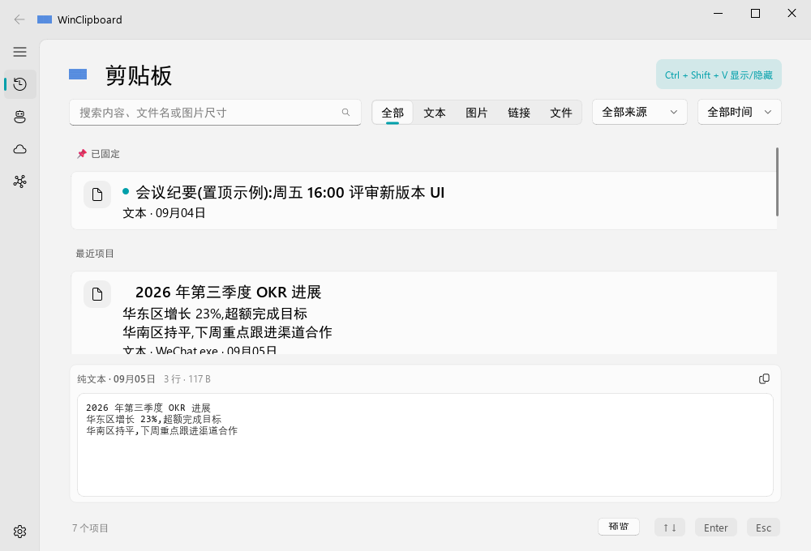

结构:左侧 FluentWindow 导航(剪贴板/工作流/AI 服务/私密区/设置在底部)
→ 搜索框 → 分类 SegmentedWidget + 来源/时间下拉 → 卡片流(置顶分组
置顶显示,选中高亮)→ 底部 Ditto 式预览面板(代码高亮/JSON 美化/图片
缩放,可一键复制完整原文)→ 底栏计数与预览开关。

深色主题(同一页面,调色板整体派生切换):

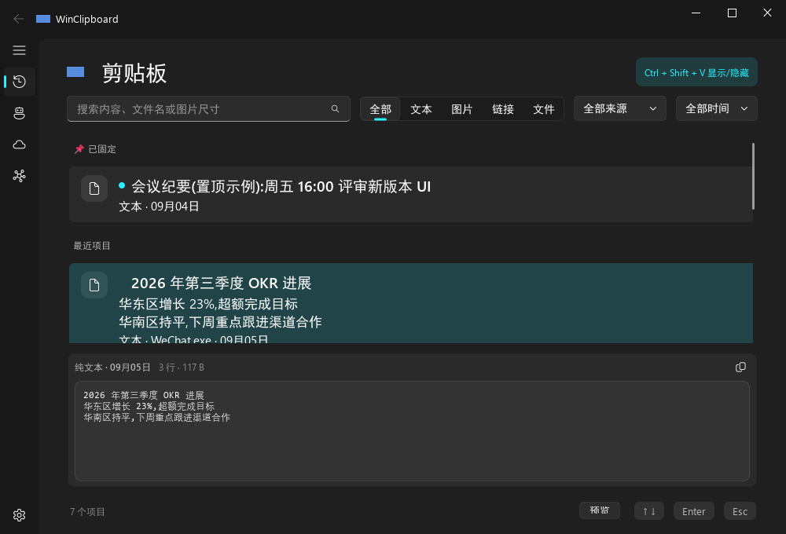

已实现:实时搜索(Search DSL `type:` `src:` `since:` 等)、类型/来源/时间
筛选、置顶分组、Shift+点击段选 + 批量删除(可撤销)、Ctrl+点击两条做
内容对比、右键菜单(复制/置顶/删除/独立查看/工作流/图片处理/钉到画布)、
悬停 4 动作钮、双击智能打开(链接→浏览器/文件→默认程序/文本图片→查看器)。

### 3.2 工作流页

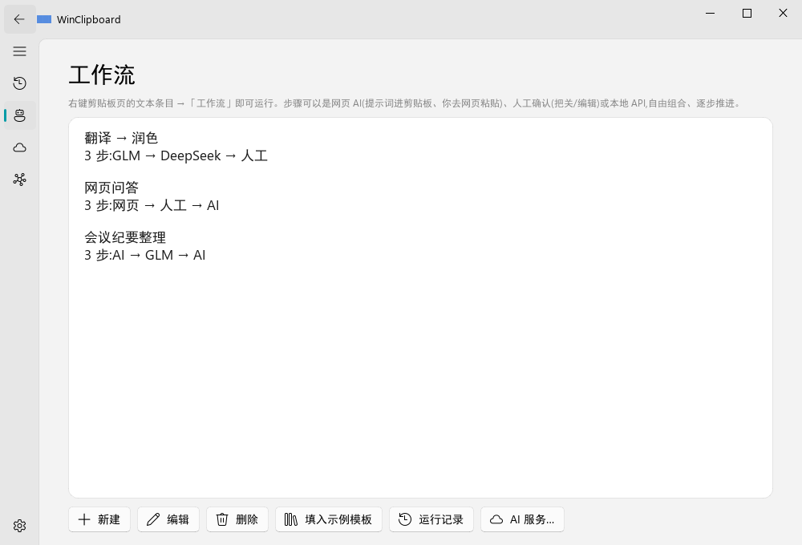

工作流中枢:卡片列出已配置的多步骤工作流(内置示例:翻译→润色、网页
问答、会议纪要整理),可新建/编辑(六类步骤:API AI / 网页 AI / 人工
确认 / 复制 / 变换 / 条件闸,支持 `before:/until:` DSL 与
`{input}/{previous}/{origin}` 上下文);打开时自动置顶面板让位;
运行台有 Run Inspector 运行记录(原子落盘、脱敏)。

### 3.3 AI 服务页

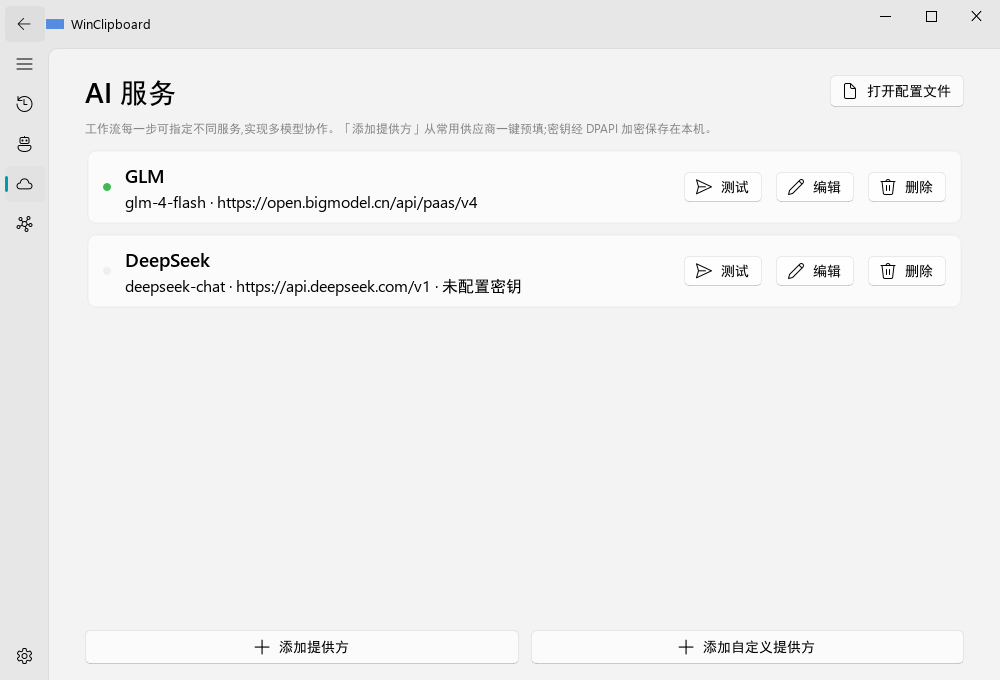

多服务管理:名称/Base URL/模型/密钥;密钥写入即 DPAPI 加密,**加密失败
不降级明文、保存失败如实弹窗**;服务可测连接;空服务名=默认服务。

### 3.4 私密区页

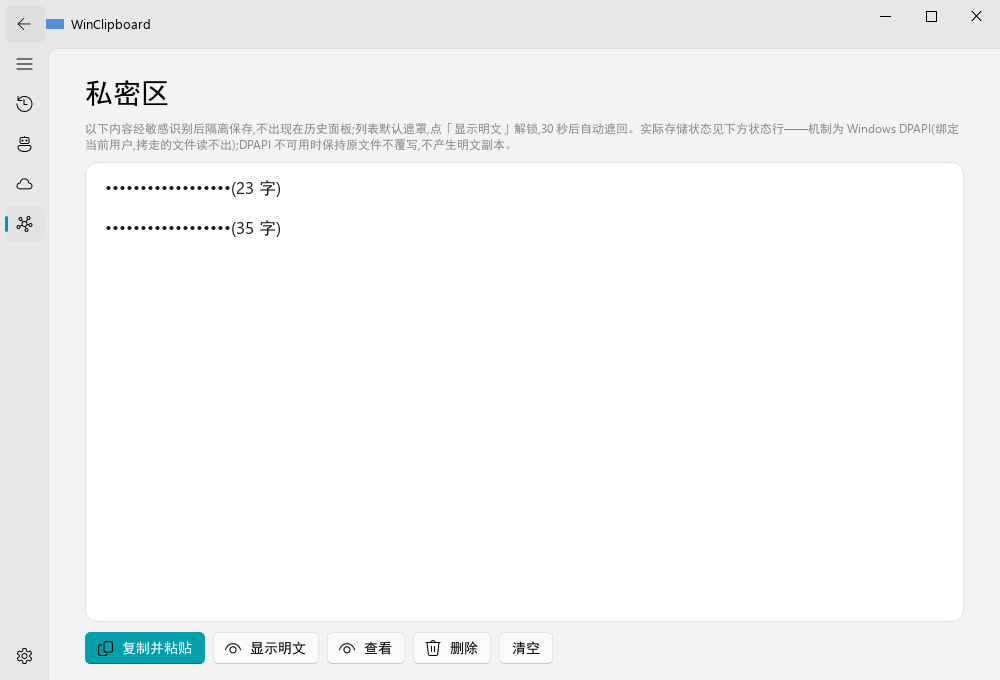

敏感内容隔离区:列表默认**遮罩显示**,点「显示明文」解锁,30 秒或离开
页面自动重新遮蔽(防旁人扫屏);顶部状态行如实显示存储实况
(DPAPI 已加密 / 旧明文 / 无法读取 / 尚未保存),不可读时禁止自动覆写、
保留备份链可恢复。

### 3.5 设置页

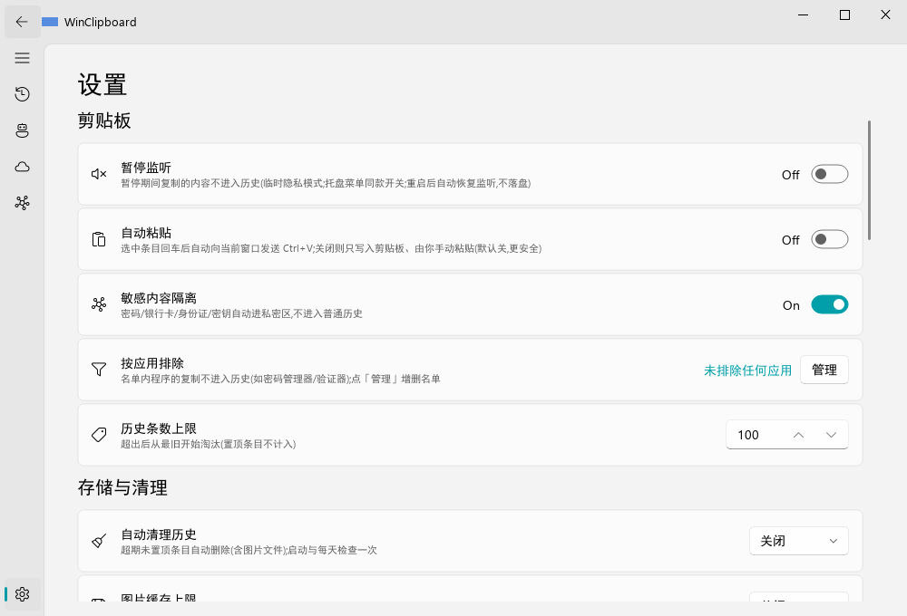

六组 qfluentwidgets SettingCard:**剪贴板**(暂停监听/自动粘贴/粘贴防护/
容量上限)、**存储与清理**(历史加密 DPAPI、孤儿清理、清空未置顶)、
**备份与迁移**(AES-256-GCM 可迁移加密备份)、**外观与系统**
(主题/Mica/开机自启/热键)、**诊断**(诊断快照、数据健康检查、
安全模式)、**关于与更新**(版本检查)。

## 4. 卫星窗口与浮层

### 4.1 快捷粘贴浮层(`Alt+``)

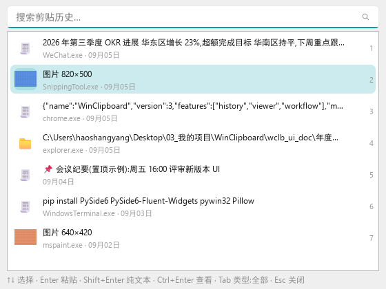

三击内拿回任何近期内容:打开 → 输入即过滤 → `↑↓` + `Enter` 粘贴;
`Tab` 切类型,`Shift+Enter` 纯文本,`Ctrl+Enter` 进查看器。
行 delegate 自绘(类型图标/标题/来源/时间),页脚是快捷键速查。
写入失败时浮层不收起、留在原地可重试。

### 4.2 内容查看器(九视图)

双击条目打开的独立阅读窗口,自动识别内容类型:

| 视图 | 截图 |
| --- | --- |
| 代码(高亮 + 行号 + 浮动查找 + 字号缩放) | 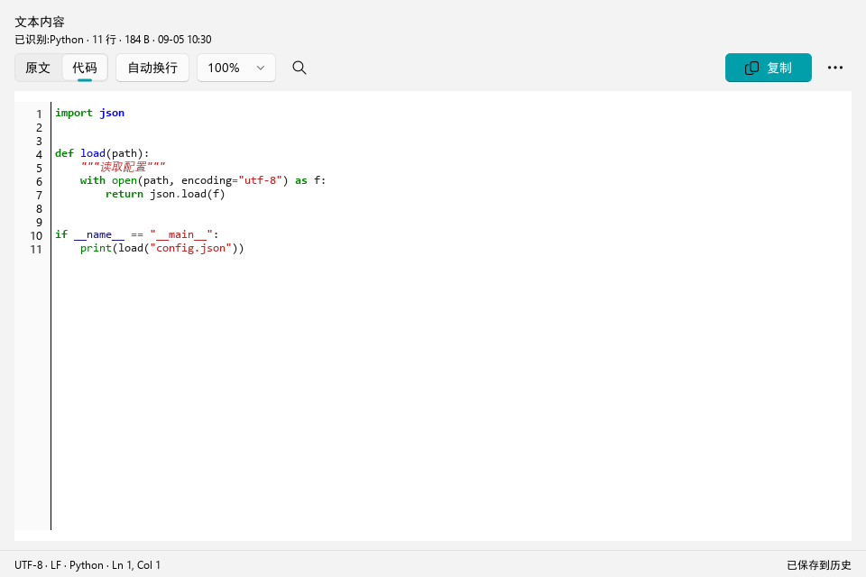 |
| JSON(格式化默认;结构树懒加载) | 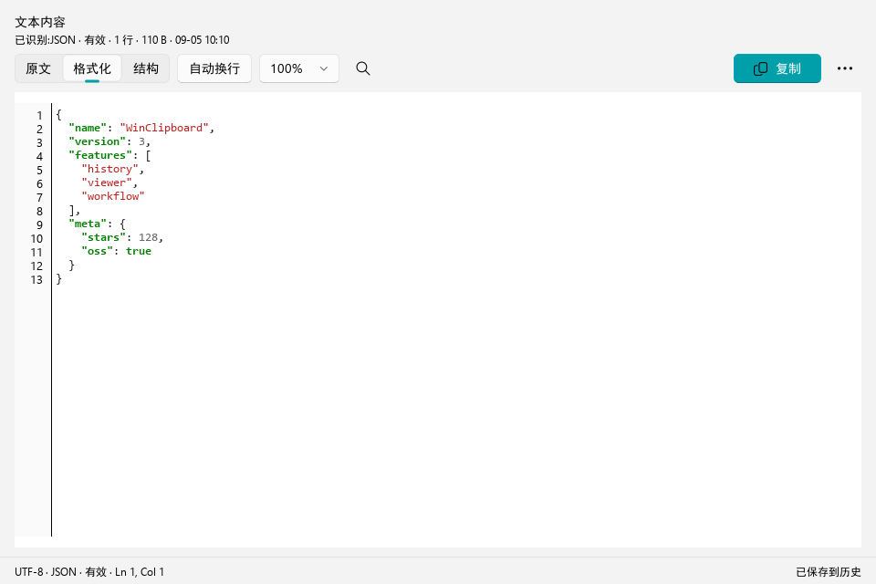 |
| Markdown 预览 | 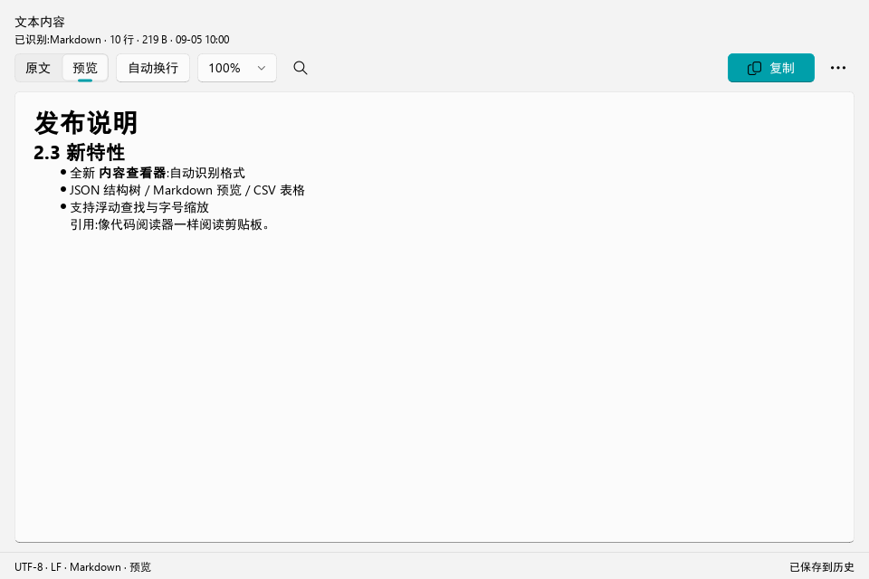 |
| CSV 表格 | 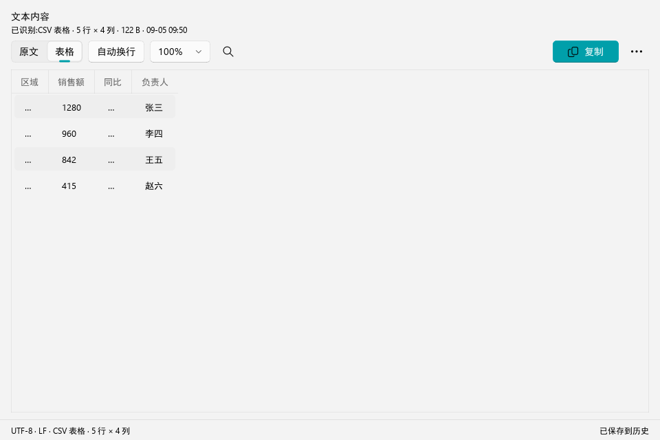 |
| 文件列表 | 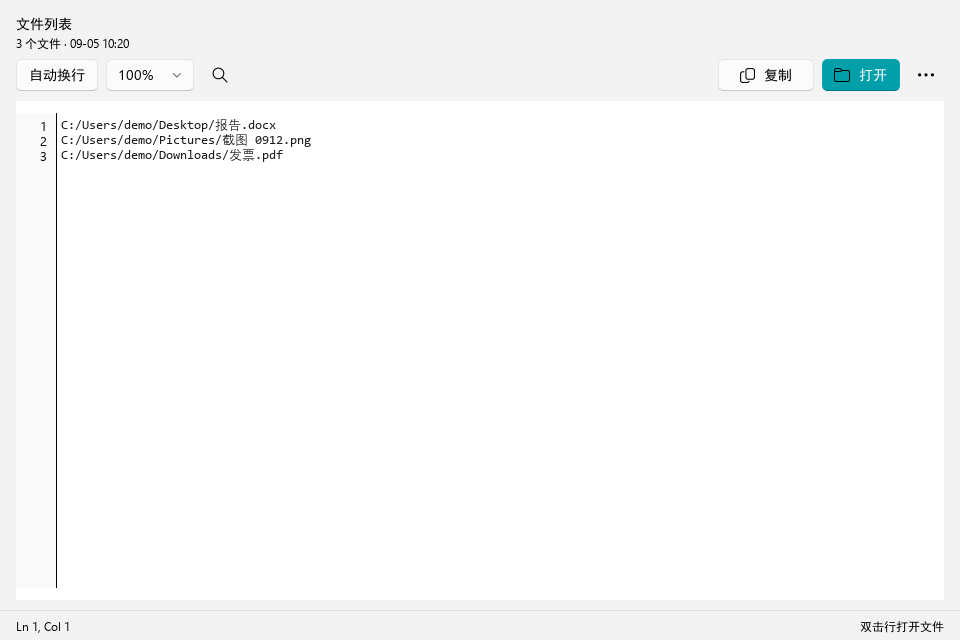 |
| 图片(缩放平移) | 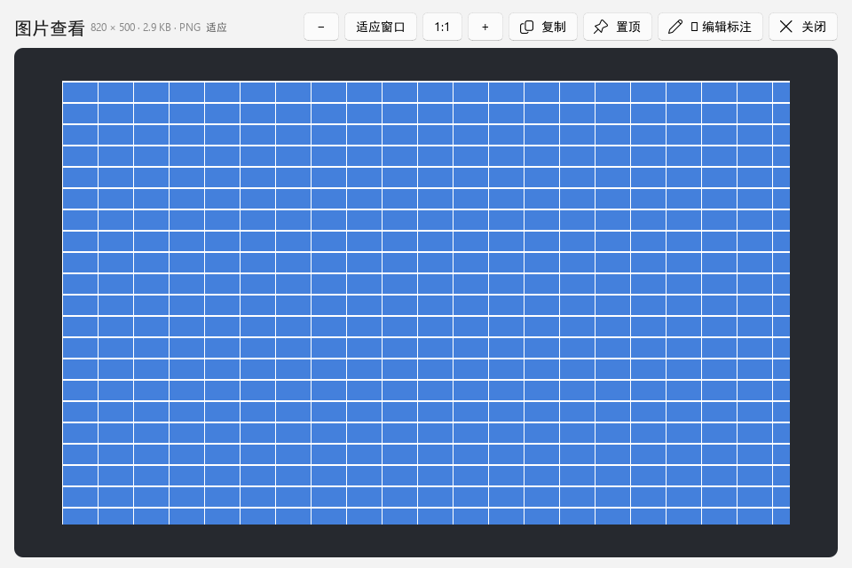 |

另有:原文/格式化/结构三态切换、双编辑器换页(编辑原文/编辑格式化)、
URL/JWT Inspector(双击字段行即复制该值)、Ctrl+点击两条的
**内容对比窗口**(文本 unified diff / JSON 语义 diff):

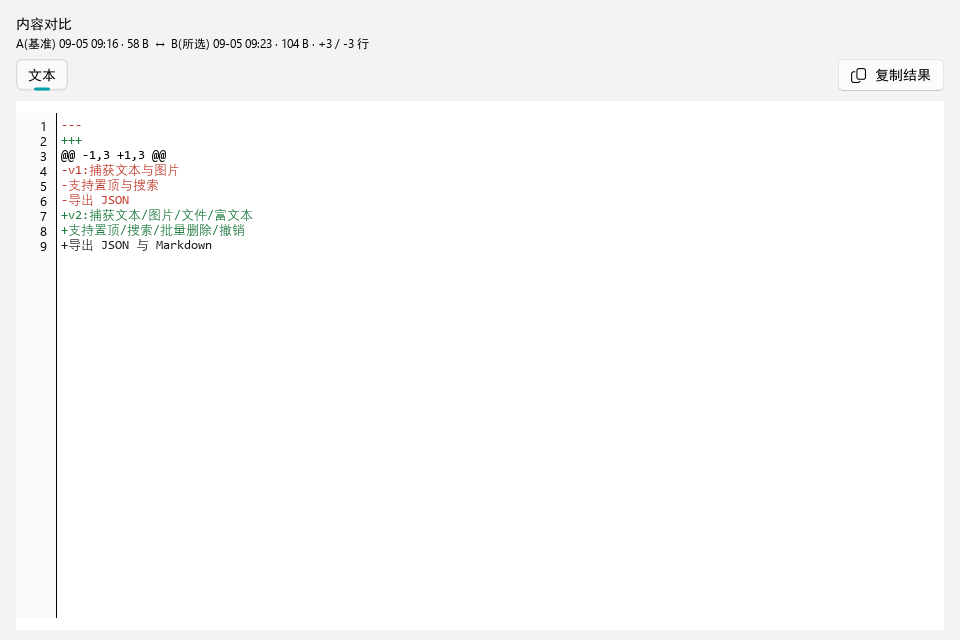

### 4.3 图片编辑器

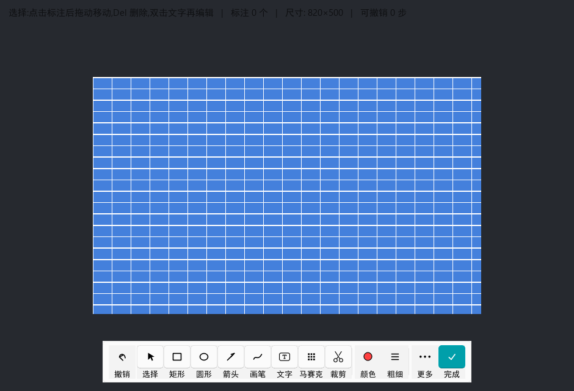

QQ 风格底部居中工具条(选择/裁剪/方框/椭圆/箭头/画笔/文字/马赛克
八件套),工具保持激活可连续标注;状态角标鼠标穿透;完成=主题色主按钮。

标注过程(方框/椭圆/文字叠加,全部矢量图元,可再选中/拖动/撤销):

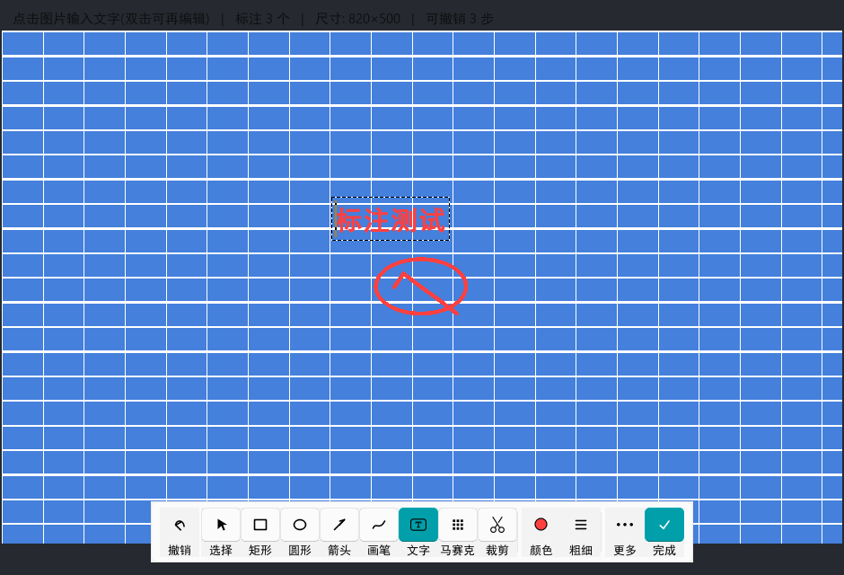

**非破坏**:底图像素不被栅格化污染(回归断言逐像素验证),导出时才合成;
另有压缩/缩放对话框。装了 ShareX 时右键优先调 ShareX。

### 4.4 图钉画布

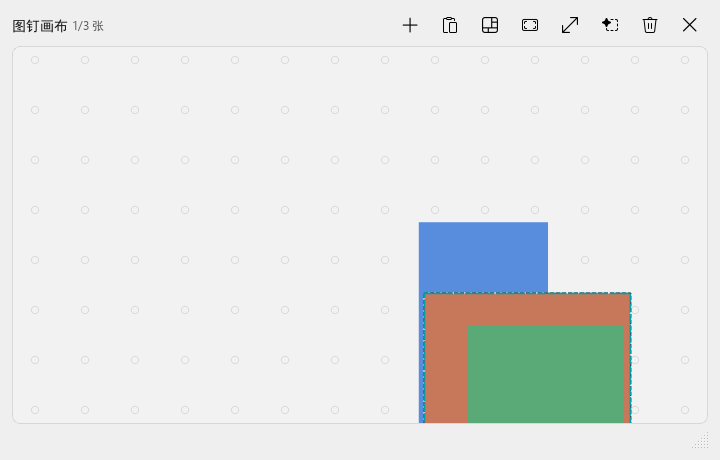

置顶大画板:点阵软木板风格,图片钉可拖动/成组/旋转(`R`/`Alt+滚轮`
细粒度)/锁定(角标)/透明度/层级;空白拖动框选、滚轮缩放整板、
单图悬停滚轮锚点缩放;右键图片可 ✏ 编辑标注(复用上面的编辑器,
标注层随画板资产持久化);从历史添加/自动排列/对齐分布。
画布为独立资产(`board.json` v2),删历史不影响。

## 5. 键盘与交互摘要

| 场景 | 按键 |
| --- | --- |
| 全局 | `Ctrl+Shift+V` 主窗口、`Alt+`` 浮层、`Ctrl+Shift+P` 钉图 |
| 主窗口 | 输入即搜;`↑↓` 选择;`Enter` 粘贴;`Delete` 删除;`Shift+点击` 段选;`Ctrl+点击` 对比;`Esc` 任意页收起;`F1` 帮助 |
| 浮层 | `↑↓`/`Enter`/`Shift+Enter`/`Ctrl+Enter`/`Tab`/`Esc`(收起并回到原窗口) |
| 画布 | `Space+拖`/中键平移、`R`/`Shift+R` 旋转、`L` 锁定、`Home/End/PgUp/PgDn` 层级、`Del` 移除、`Esc` 收起 |
| 查看器 | 浮动查找、字号缩放、双编辑器换页 |

## 6. UI 质量保障(这些截图怎么来的)

- **离屏渲染测试**:`_ui_preview.py` 每次输出截图前跑 **17 项几何/像素
  断言**(工具条居中/八件套齐全/图像区无遮挡邻域采样/标注矢量性/底图
  未被污染/导出含标注/撤销链路…),本文截图即其产物,2026-10-12
  浅色/深色各 17/17 PASS。
- **全页面截图脚本**:`_ui_doc_shots.py`(本文新增)渲染主窗口五页 +
  浮层 + 查看器七视图,浅/深两套,`docs/ui/2026-10-12/` 共 32 张。
- **回归护栏**:`_module_split_test` 56 项(含调色板跨模块同步、九类
  查看器构造渲染、编辑器/画布像素断言);`run_checks.py` 12 套必需
  全绿;`_integration_test` 真实核心+真实面板全链路。
- **截图与真实桌面的差异**:离屏平台无 Mica 合成(截图为回退纯色背景,
  真实 Win11 桌面是半透明云母材质)、无真实热键/托盘;数据为脚本注入
  的演示数据。

## 7. 现状评估

**强项**:界面结构统一(单窗口五页,无多窗口割裂);库原生 Fluent 风格
一致性好;每个界面都有离屏断言或像素回归兜着;深浅主题全量派生、
覆盖所有自绘部分;性能架构(分批/滑窗/后台缩略图)已把大列表的 GUI
冻结消除。

**已知短板**(与代码现状一致):
1. 卡片创建吞吐 ~4-6ms/张(qfluentwidgets 标签+QSS 成本),深滚动
   后台填充 80 卡块需 1-2s——结构性出路是 QListView+delegate 虚拟列表,
   前置依赖稳定记录标识(已有评估文档,未实施);
2. 真实桌面验收(热键实弹/向真实应用粘贴/Mica 实际观感)仍未安排,
   离屏截图不能替代;
3. 分类徽章的识别语料 41 条,边界场景(短中文/混合格式)覆盖薄。

## 附:截图复现方法

```bash
# 17 项断言 + 编辑器/画布截图(浅色与深色)
./.venv/Scripts/python.exe _ui_preview.py light
./.venv/Scripts/python.exe _ui_preview.py dark
# 主窗口五页 + 浮层 + 查看器(输出 docs/ui/2026-10-12/)
./.venv/Scripts/python.exe _ui_doc_shots.py light
./.venv/Scripts/python.exe _ui_doc_shots.py dark
```

两脚本均为离屏 + 临时目录数据,不接触真实历史、配置与系统剪贴板。
